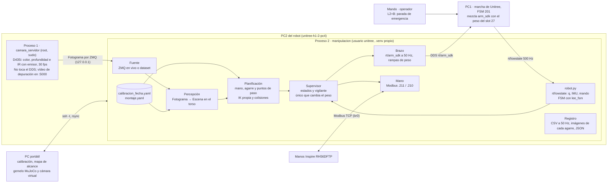
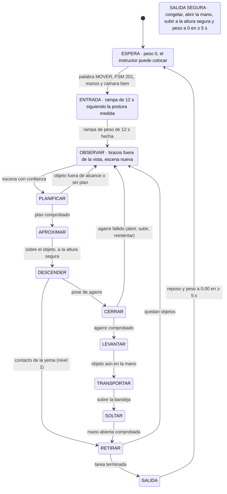

# Plan del reto: H1-2 manipulación

Plan de trabajo del reto `R40-RT-H1_2-0002` (clasificar objetos con brazos, manos y cámara sin mover el
cuerpo), creado el 2026-10-09. Se avanza según este plan, pero puede cambiar con los resultados; lo
medido y lo que cambie irá a [RESULTADOS.md](RESULTADOS.md), que se crea con la primera medida. Las
casillas de [Orden de implementación](#orden-de-implementación) marcan el avance real.

El sistema corre en el PC2 del robot en dos procesos, como el seguidor de línea: la cámara como root y
el resto como `unitree`, porque el DDS no arranca con sudo. Los brazos van por `rt/arm_sdk` y las manos
por Modbus TCP, mientras la marcha de Unitree equilibra el cuerpo en FSM 201. La PC desarrolla, calibra
y comprueba sin robot, con un gemelo del montaje en MuJoCo que tiene cámara virtual. Se valida por
hitos: alcance y mesa fijada, calibración y caracterización, percepción y planificación sin robot,
simulacro y tiradas al doble de la duración mínima.

## Punto de partida

Medido el 2026-10-09 con el robot en FSM 201 y sin mover nada: una captura de la D435i tras recolocar la
mesa y la IK propia sobre el URDF del repo. Son medidas preliminares; las calibradas irán a
RESULTADOS.md.

| Qué | Valor | Cómo se obtuvo | Qué implica |
| --- | --- | --- | --- |
| Estado del robot | FSM 201, `CheckMode='ai'`, 27/27 motores sin fallo, `mode_machine` 6; D435i a 5000 Mbps; manos .211 (izq) y .210 (der) abiertas y sin error | `estado.sh`, `lee_fsm eth0`, `camara.sh usb`, `manos.sh leer` | Repetir antes de cada tirada |
| Mesa | Carrito negro brillante de 79.5 × 50 cm, superficie a 85.5 cm del suelo, labio de ~2.5 cm, seis alfombrillas grises, asas laterales hasta ~15 cm sobre la superficie, ruedas con freno | Usuario y profundidad | Labio y asas son obstáculos: entran en el gemelo y en la comprobación de colisiones |
| Posición de la mesa | Borde cercano a 0.30–0.33 m de la pelvis (d ≈ 17–20 cm del pecho), ~3 cm a la derecha del eje del robot, girada ~2.5° | ArUco 3, 4 y 5 en el IR, proyectados al plano | Dentro de los 10–35 cm del PDF. El marco de la mesa sale de los ArUco, sin suponerla recta |
| Plano y cámara | Cámara a 0.805 m de la mesa; pelvis a 0.973 m del suelo y mesa a −0.118 m de la pelvis; eje óptico 51.7° bajo el plano (el URDF dice 50.8°), roll 0.5° | RANSAC sobre 15 fotogramas de profundidad, residuo 3 mm | El torso va ~1° inclinado: la pose del URDF solo sirve de semilla de la calibración |
| Campo de visión sobre la mesa | Color desde x ≈ 0.36 m (FOV V 43.4°); IR y profundidad desde x ≈ 0.21 m (FOV V 64.7°) | Esquinas de la imagen proyectadas al plano | La zona de recogida empieza en x ≈ 0.40 m; los ArUco cercanos se leen en el IR |
| Profundidad | 92–99 % de píxeles válidos sobre el negro con emisor, ruido ~3 mm; las esferas salen con 43–52 mm de alto (miden 65–70); reflejos falsos de 15–25 mm | Captura con emisor | Centro de las esferas por ajuste de círculo y diámetro conocido; filtrar manchas por tamaño |
| Alcance por IK (en la pelvis; límites web∩URDF − 0.05 rad) | Tocar con la yema: x ≤ 0.50–0.55 m. Agarre desde arriba: x ≤ 0.50. Agarre de lado con los dedos 15–55° hacia abajo: x ≤ 0.55. De lado con los dedos horizontales: imposible, porque el brazo no baja la muñeca hasta la mesa. Soltar a 10–15 cm: x ≤ 0.60 | IK propia (pinocchio), rejilla de 5 cm, sin colisiones todavía | Banda útil de agarre con color: x 0.40–0.52 m. Las dos manos cubren \|y\| ≤ 0.10–0.15 m |
| Giro de la mano en planta | ~60–90° por mano con agarre desde arriba en el centro de la zona | IK con orientación, cada 30° | El giro de 90° del nivel 4 quizá no sale con un solo agarre |
| Manos (caracterización de `inspire_hand_interface`) | Con FORCE_SET 500 se pasa +112 gf a SPEED 50, +202 a 100 y +637 a 250. Fuerza sostenible de 455–745 gf por dedo según la pose. El dedo marca 70–232 gf solo por doblarse. Cubo: con 2 dedos 279/507 gf e inestable; con 3, 295/179/341 gf y estable. Si FORCE_ACT llega a FORCE_SET, el dedo deja de aceptar ANGLE_SET (en banco). Tras sujetar, el cero se corre 21–46 gf durante ~8–10 s | `Caracterizacion/exp2`, `exp3` y `Control/` | SPEED ≤ 100 al cerrar, FORCE_SET de 250–450 gf, comprobar que la mano abre, línea base con la mano abierta y ≥ 10 s sin carga |
| ArUco | DICT_4X4_50 de 5 cm (la profundidad da 46–49 mm: medir con regla). ID 0 dorso izq, 1 dorso der, 2 esquina lejana izq, 3 lejana der, 4 cercana izq, 5 cercana der | Detección en las fotos y en la captura | `DICT_4X4_250` da un falso ID 190 dentro del 3: usar la de 50 |
| Objetos | Pelota de tenis amarilla (7 cm, 58.7 g), cubo PLA blanco (6 cm, 60.5 g), prisma alargado (por imprimir) y un cuarto por decidir. La bola de espuma (21.7 g) queda fuera | Usuario y báscula | Ver [Montaje acordado](#montaje-acordado) |
| Bandejas | Hueco 12 × 12 cm, pared de 3 mm y 4 cm de alto; blanca, roja, azul y una cuarta | Usuario | Soltar con el objeto por encima de 4 cm: la mano a ~10–12 cm de la mesa |
| PC2 | x86_64, Ubuntu 22.04, Python 3.10.12, con internet. `unitree_sdk2py` en `~/pc2_offline/src/unitree_sdk2_python`. env_tv: cyclonedds 0.10.2, numpy 1.26.4, scipy 1.15.2, opencv 4.11.0.86, pyrealsense2 2.58.4, pymodbus 3.6.9, pyzmq 27.2, pinocchio 3.1 | `uname`, `pip list` | Entorno propio en `~/utec/manipulacion/.venv` con esas versiones |
| PC | mujoco 3.14, pinocchio 4.1, cv2 4.11 | Importación | Gemelo y comprobaciones en la PC; la cinemática debe funcionar con pinocchio 3 (robot) y 4 (PC) |

## Montaje acordado

Coordenadas en el marco del torso (coincide con la pelvis con la cintura a 0): x adelante, y a la
izquierda, z arriba. Las posiciones se fijan en el Hito 1 con el mapa de alcance con colisiones, y se
colocan con `marcar_montaje.py`, que pinta el objetivo sobre la imagen en vivo.

| Elemento | Posición inicial | Por qué |
| --- | --- | --- |
| Mesa | Borde cercano a ~0.32 m, centrada en el eje (hoy ~3 cm a la derecha), con frenos; no se mueve en toda la sesión | d ≈ 19 cm del pecho. Acercarla no ayuda: el color no ve antes de 0.36 m |
| Zona de recogida (desviación aceptada) | x 0.40–0.52, y −0.13…+0.13: unos 26 × 12 cm, frente a los 40 × 25 del PDF | Es lo que ve el color y alcanzan las dos manos con un agarre válido |
| Bandejas A y B (izquierda) | Centros en (0.42, +0.27) y (0.56, +0.27) | Las alcanza la mano izquierda soltando a 10 cm; quedan a unos 4 cm de la zona y lejos de las asas |
| Bandejas C y D (derecha) | Centros en (0.42, −0.27) y (0.56, −0.27) | Espejo de las anteriores |
| Dianas del nivel 1 | Cuatro pegatinas de 2 cm con una cruz, al azar dentro de la zona | — |
| Cruz del nivel 4 (desviación) | Centro de la zona, (0.46, 0) | El centro del tablero (x ≈ 0.57) no se alcanza |
| Huellas de los pies | Cinta alrededor de los dos pies, con la mesa ya fijada | Un pie que sale 5 cm de su huella cuenta como paso |
| Orden | Medir el montaje con la mesa vacía y después poner las bandejas | La bandeja A tapa el ArUco 4 (RESULTADOS §1) |

Si el mapa con colisiones recorta las esquinas lejanas de la zona para la mano del lado contrario, la
zona se queda en trapecio o se usa la entrega de mano a mano (6.4.6). La mano contraria no llega a las
bandejas del otro lado: cada objeto lo coge la mano del lado de su bandeja.

Objetos, que el instructor asigna a las bandejas:

| Objeto | Medidas y peso | Agarre inicial | Riesgos |
| --- | --- | --- | --- |
| Pelota de tenis amarilla | Ø 7 cm, 58.7 g | Desde arriba con 4–5 dedos, o de lado inclinado; FORCE_SET a medir (no hay datos de banco) | Rueda al tocarla y rebota; la profundidad la ve baja |
| Cubo PLA blanco | 6 cm, 60.5 g | Tres dedos (pulgar, índice y medio) o mano completa; nunca pinza de dos | Brillos del PLA; blanco como la bandeja blanca y el papel de los ArUco (se separan por altura) |
| Prisma naranja | 4 × 4 × 10 cm tumbado, PLA (pesar) | Desde arriba, a lo ancho (4 cm), con el ancho de la mano a lo largo | Es el objeto del giro de 90° del nivel 4; con la mano de su bandeja se coge en ~80 % de sus orientaciones |
| Cilindro azul | Ø 5 × 8 cm de pie, PLA (pesar) | De lado inclinado o desde arriba | Da la cuarta forma; por su altura, se suelta más arriba |

## Arquitectura



El bloque de calibración son herramientas aparte: graban en el robot, calculan en la PC y escriben un
YAML con fecha. El proceso 2 lo lee al arrancar y no lleva ninguna transformación escrita en el código.

## Interfaces entre bloques

Cada bloque es una función sobre estos mensajes y no importa el SDK, salvo `robot.py`, `brazo.py` y
`mano.py`. Así la percepción corre igual sobre el dataset que en vivo, la planificación se prueba contra
el gemelo y la mano sin cámara. Irán en `manip/mensajes.py`.

Convenciones:

- Marco del torso (`torso_link` con la cintura a 0, que coincide con la pelvis): x adelante, y a la
  izquierda, z arriba. Metros y radianes; yaw en planta positivo antihorario.
- Tiempos con `time.monotonic()` del PC2; cada mensaje lleva su `t`.
- Juntas en el orden de arm_sdk: 12 cintura, 13–19 brazo izquierdo, 20–26 brazo derecho. Manos: DOF 0–5
  (meñique, anular, medio, índice, flexión del pulgar, rotación del pulgar); 0 cerrado, 1000 abierto.
- Ninguna transformación en el código: todas salen de `config/calibracion_<fecha>.yaml` y
  `config/montaje.yaml`.

| Mensaje | De → a | Campos (unidades) | Frecuencia |
| --- | --- | --- | --- |
| `Fotograma` | fuente → percepción, registro | `n`, `t_cam` (s), `t_rx` (s), `color` (BGR 640×480), `prof` (uint16 en mm, marco del IR izquierdo), `ir` (opcional), intrínsecos de color y profundidad, extrínseco profundidad → color, `emisor` | 30 Hz |
| `EstadoRobot` | `robot.py` → vigilante, planificación, supervisor, registro | `t`, `q`, `dq`, `tau` (27), `imu` (roll, pitch, yaw, gz), `fsm`, `motores_en_fallo`, `mando` (botones y ejes), `peso_armsdk`, `edad` | 500 Hz leído, 50 Hz registrado |
| `EstadoMano` | `mano.py` → supervisor, registro | `t`, `lado`, `angulo[6]`, `fuerza[6]` (gf), `base[6]` (gf, mano abierta), `force_set[6]`, `tactil` (solo las zonas pedidas), `error[6]`, `estado[6]`, `edad` | ~30 Hz por dedo |
| `Calibracion` | herramientas → todos (YAML con fecha) | `T_torso_ir`, `T_ir_color` (4×4), `T_dorso_izq`, `T_dorso_der` (marcador en `*_wrist_yaw_link`), `plano_mesa` (n, d en el torso), `residuo_mm` (medio y máximo), `n_poses`, `fecha` | Una por sesión |
| `Montaje` | `medir_montaje.py` → percepción, planificación, gemelo (YAML) | Marco de la mesa (origen y yaw), labio, asas, zona de recogida, bandejas A–D (centro, hueco y alto), cruz, objetos (clase, medidas, color) | Una por sesión |
| `Escena` | percepción → planificación, supervisor | `t` del fotograma, `ms` de proceso y, por objeto: `id`, `clase`, `p` (centro en el torso, m), `yaw` (rad, módulo su simetría), `medidas`, `confianza` (0–1), `visible`, `movido` (respecto de la escena anterior) | 5–30 Hz |
| `Plan` | planificación → supervisor | `objeto`, `mano`, `agarre` (preforma; FORCE_SET y SPEED por dedo; pose de agarre en el torso), `puntos_de_paso` (q de 7 juntas + duración), `pose_suelta`, `bandeja`, `comprobado` (límites, velocidad, altura segura y colisiones en el gemelo) | Uno por objeto, rehecho antes de cada agarre |
| `OrdenBrazo` | supervisor → brazo | `lado`, `q_obj` (7), `duracion` (s, ≥ la mínima medida), `perfil` (mínima sacudida), `kp` (≤ 150), `kd` | Por segmento |
| `OrdenMano` | supervisor → mano | `lado`, `accion` (preforma, cerrar, sujetar, soltar, abrir), `force_set[6]` (≤ 800), `speed[6]`, `angulos[6]` | Por acción |
| `Salud` | vigilante → supervisor | `fsm`, `motores_en_fallo`, `edad_lowstate`, `edad_fotograma`, `mano_ok[2]`, `paso` (y la junta que lo delata), `yaw_desde_inicio`, `roll`, `pitch`, `error_seguimiento` (rad), `fuerza_max` (gf), `parada` (tecla o botón) | 50 Hz |
| `Decision` | supervisor → registro | `estado`, `motivo`, `objeto`, `peso`, `simulacro` | 50 Hz |

## Gemelo del montaje en MuJoCo

Una recreación del montaje medido para comprobar en la PC, sin robot, la cinemática, el alcance, las
colisiones, las trayectorias, la percepción y la calibración. Se construye con `mujoco.MjSpec` sobre
`h1_2_mujoco/modelo_h1_2_manos.py`, que ya carga el URDF con manos, impone las 12 juntas mimic y
comprueba colisiones. Todas las medidas salen de `config/montaje.yaml` y de la calibración: el gemelo
no lleva números escritos.

**Contenido** (`sim/escena.py`):

- **Robot:** URDF con manos del repo, con la pelvis fija a la altura y la inclinación medidas (0.973 m,
  ~1°), las piernas en la postura de pie leída de `rt/lowstate` y la cintura a 0. Los brazos y las
  manos toman la q medida o la planificada.
- **Mesa:** tablero, labio, asas (cápsulas), alfombrillas y estructura del carrito, en la pose de
  `montaje.yaml`.
- **Elementos del reto:** bandejas A–D (pared de 3 mm y 4 cm de alto), objetos con sus medidas y
  colores, dianas y cruz.
- **ArUco 0–5:** texturas reales generadas con `cv2.aruco`, en las esquinas de la mesa y en el dorso de
  cada mano.
- **D435i virtual:** dos cámaras en `torso_link`. Una de color (640×480, fovy 43.4°) y otra de
  IR/profundidad (640×480, fovy 64.7°). Llevan la pose del URDF hasta tener la calibración, y después
  la calibrada.

| Comprobación | Cómo | Criterio | Cuándo |
| --- | --- | --- | --- |
| Cinemática | FK de `cinematica.py` (pinocchio) frente a MuJoCo en 1000 q al azar: yema, punto de agarre, dorso y cámara | < 1 mm | Fase 0 |
| Alcance con colisiones | `mapa_alcance.py`: IK y colisión de mano y antebrazo con mesa, labio, asas, bandejas y cuerpo, por mano y tipo de agarre (también el giro en planta) | Mapa del Hito 1; elige d, la zona y la cruz | Hito 1 |
| Trayectorias | Cada `Plan` muestreado a 50 Hz: límites, ≤ 0.5 rad/s, nada bajo la altura segura salvo el descenso final, distancia a mesa, bandejas, cuerpo y el otro brazo | Ningún contacto previsto; holgura ≥ 2 cm | En el planificador, siempre; informe en el Hito 3 |
| Percepción con la cámara virtual | Imágenes de color y profundidad con los objetos en poses al azar, la mano tapando el objeto y un objeto movido | Error de centro y de yaw frente a la verdad del simulador; % de reconocimiento | Antes del Hito 2, sin robot |
| Calibración con la cámara virtual | El brazo virtual a las mismas poses que la grabación real; la calibración debe recuperar la pose conocida de la cámara | Sin ruido: < 3 mm y < 0.3° | Fase 0 |
| Calibración real | Render con la pose calibrada superpuesto a la imagen real: bordes de la mesa, ArUco, bandejas y la mano | Desfase en píxeles, convertido a mm | Hito 2 |
| Reproducción | `reproducir_mujoco.py` con la q medida en el CSV y, al lado, las imágenes grabadas | Ver qué hizo de verdad el brazo (la caída de ~5°, contactos) | Hito 3 y tras cada tirada fallida |
| Caída del brazo (opcional) | Con gravedad, actuadores de posición con kp 100–150 y kd 2 en los brazos, y la pelvis fija | Comparar con el error medido en el robot | Hito 2 |

Límites del gemelo: no simula la marcha (la pelvis está fija), así que ni pasos ni giro; las fuerzas de
contacto de la mano no son fiables; y corre en la PC, no en el PC2. Los pasos y las fuerzas solo se
miden en el robot. Las "trayectorias reproducidas en MuJoCo" del Hito 3 son las de esta sección; el
simulador C++ de `unitree_mujoco` no implementa `rt/arm_sdk`.

## Decisiones técnicas iniciales

Son puntos de partida, no respuestas: cada valor se sustituye por el medido y entra en el informe con
su método.

| Pregunta del PDF | Decisión inicial | Cómo se valida |
| --- | --- | --- |
| 6.1.1 Alcance y d | IK propia con posición y orientación con tolerancia: palma abajo ≤ 35°, de lado con los dedos 15–55° abajo, yema abajo ≥ 45°; colisiones en el gemelo | Mapa por mano y por agarre; la d elegida y su porqué |
| 6.1.2 Qué ve la cámara | Plano RANSAC con emisor; color desde 0.36 m e IR desde 0.21 m | Error del plano y de los ArUco sobre la mesa vacía, contra la regla |
| 6.1.3 Cámara–torso | Dorso a ≥ 15 poses por mano con la q **medida**; mínimos cuadrados no lineales sobre `T_torso_ir` y `T_dorso`, empezando con Kabsch y la pose del URDF | Residuo medio y máximo; calibración probada antes sobre la cámara virtual |
| 6.1.4 Consigna frente a medida | Calibrar con la q medida; la diferencia con la consigna es la caída del brazo y se modela aparte | Comparar las dos calibraciones |
| 6.1.5 Vibración de la cámara | ArUco fijo de la mesa durante 60 s con el robot quieto | Desviación en mm |
| 6.2.1 Color o profundidad | Lo que sobresale del plano separa; el color solo identifica | % de detección en el dataset |
| 6.2.2 Reconocimiento | Color (HSV), altura, tamaño en planta y forma (círculo frente a rectángulo) | Matriz de confusión con los cuatro objetos |
| 6.2.3 Centro y yaw | Esferas: círculo y diámetro conocido. Cubo y prisma: rectángulo de la cara superior en la vista desde arriba, yaw módulo 90° y 180° | Contra la regla y contra la verdad del gemelo |
| 6.2.4 Brazo y mano en la imagen | Máscara del propio robot proyectando cápsulas de los eslabones con la FK y la calibración | Ningún objeto falso con el brazo a la vista |
| 6.2.5 Oclusión | Pose medida antes del descenso, con el brazo fuera de la vista, y confirmación por la mano (fuerza y táctil) | Distancia a la que se pierde el objeto en el dataset |
| 6.2.6 Objeto movido | Se vuelve a percibir antes de cada agarre; un objeto se da por movido si se desplaza > 2 cm o gira > 10° | Prueba con el objeto desplazado 5–10 cm |
| 6.3.1–2 Pasos frente a duración | Curva a 8, 10, 20 y 30 s con la IMU y las juntas de las piernas; duración mínima y presupuesto por objeto en el YAML | Curva de pasos y giro |
| 6.3.3 El otro brazo | Quieto en reposo; probar el contrapeso de `caja_cuadrado.py` si la curva lo pide | Pasos con y sin contrapeso |
| 6.3.4 Error de ~5° | kp ≤ 150, precompensar la consigna con un modelo de la caída (gravedad / kp) y corregir con el dorso visible antes del descenso final | Error de la yema en el nivel 1 |
| 6.3.5 Articulares o cartesianas **(revisado)** | Puntos de paso cartesianos resueltos con IK y movimientos articulares de mínima sacudida entre ellos; altura segura de 15 cm (10 cm al soltar) | Los puntos altos van a 18 cm: entre ellos el brazo bajaba 1–4 cm. Cada tirada pasa por una pose de observación: desde el reposo, subir el antebrazo barre la mesa (RESULTADOS §7) |
| 6.3.6 Cintura (índice 12) | Sujeta en la q medida al entrar, con kp 200 como en `caja_cuadrado.py` | Yaw del torso en el registro |
| 6.3.7 Fin y aborto **(revisado)** | Congelar, abrir, subir a la altura segura, ir a la observación si el tramo es limpio, al reposo solo desde ella, y bajar el peso en ≥ 5 s | Probado en el mundo simulado; con el peso en 0 desde encima de la mesa, la política barrería la mesa |
| 6.4.1 Agarre y margen | Uno por objeto (tabla de arriba), con preforma que tolere ±2 cm | Margen medido desplazando el objeto en el gemelo y en el robot |
| 6.4.2 FORCE_SET | 250–450 gf con SPEED ≤ 100; tabla por objeto medida con la báscula | Fuerza real y sobreimpulso por objeto |
| 6.4.3 ¿Hay objeto en la mano? | Dedos parados lejos de 0 con fuerza por encima de su curva de flexión libre | Mano vacía frente a mano con objeto, en el robot |
| 6.4.4 Contacto con la mesa | Táctil de la yema del índice primero; fuerza del dedo y error de seguimiento como respaldo | Cuál aparece antes y con qué umbral, con la báscula |
| 6.4.5 Soltar | Bajar a 10 cm sobre la bandeja, abrir primero el pulgar y luego los dedos, comprobar que la mano abrió y subir en vertical | El objeto queda quieto en el gemelo y en el robot |
| 6.4.6 Entrega de mano a mano **(revisado)** | Cambio de agarre por la mesa: la otra mano deja el objeto girado en la zona y la de su bandeja lo coge | Con la palma abajo el ancho de la mano solo gira ~75° (RESULTADOS §6): un prisma en ~20 % de las orientaciones lo necesita (pendiente) |
| Nivel 4 · giro de 90° | Usar todo el giro disponible entre la recogida y la cruz. Si no llega a 90°, dos reagarres de 45° sobre la cruz | Mapa de giro de la mano del Hito 1 |

## Supervisor



Solo el supervisor cambia el peso de `arm_sdk` y da un objeto por terminado. Cualquier estado con peso
pasa a SALIDA SEGURA por:

- paso detectado (pie fuera de su huella, o una junta de pierna desviada);
- yaw > 5°, roll o pitch > 10°;
- error de seguimiento por encima del fijado, o fuerza > 1200 gf;
- cámara sin fotogramas o mano sin respuesta;
- FSM distinta de 201, excepción, Ctrl+C, tecla ESPACIO o el botón de parada del mando.

En simulacro recorre los mismos estados con la cámara en vivo y registra lo que mandaría: las
trayectorias se reproducen en el gemelo y la mano abre y cierra en el aire, pero no publica en
`rt/arm_sdk`.

## A) Scripts nuevos

Todo va en `retos_capacitacion/manipulacion/`, que se copia con rsync a `~/utec/manipulacion/` del
PC2. De `~/robotics40` solo se lee, por ejemplo `lectores_h1_2/build/lee_fsm`.

Los lanzadores siguen el patrón de `seguidor_linea/comun.sh`: se reenvían solos por SSH si no están en
el robot, fijan `PYTHONNOUSERSITE=1`, quitan `CYCLONEDDS_URI`, se niegan a correr como root y usan
`~/utec/manipulacion/.venv/bin/python`. Solo `camara_servidor.sh` usa sudo, y ese proceso no toca el
DDS.

| Fichero | Bloque | Qué hace | Dónde corre | Hito | Estado |
| --- | --- | --- | --- | --- | --- |
| `README.md`, `comun.sh`, `ejecutar.sh` | — | Lanzadores con el `.venv` propio | Ambos | 0 | pendiente |
| `instalar_entorno.sh` | — | Crea `.venv` en el PC2 con las versiones de env_tv y pinocchio 3; `unitree_sdk2py` con un `.pth` hacia `~/pc2_offline/src/unitree_sdk2_python`, sin tocar esa carpeta | Robot | 0 | pendiente |
| `config/manipulacion.yaml` | Configuración | Límites de la sección 10, ganancias, duraciones medidas, altura segura, palabra de confirmación, IPs | Ambos | 0 | pendiente |
| `config/montaje.yaml` | Configuración | Mesa, labio, asas, zona, bandejas, cruz, ArUco; lo escribe `medir_montaje.py` | Ambos | 1 | pendiente |
| `config/objetos.yaml` | Configuración | Por objeto: clase, color, medidas, peso, agarre, preforma, FORCE_SET, SPEED | Ambos | 2 | pendiente |
| `config/calibracion_<fecha>.yaml` | Calibración | Lo escribe `calibrar_camara_torso.py` | Ambos | 2 | pendiente |
| `camara_servidor.py` + `.sh` | Fuente | Copia del de `seguidor_linea`: color, profundidad e IR con emisor, y el extrínseco profundidad → color en los metadatos | Robot, sudo | 0 | pendiente |
| `manip/mensajes.py` | Interfaces | Los mensajes de la tabla de interfaces | Ambos | 0 | pendiente |
| `manip/fuentes.py` | Fuente | `FuenteZmq` y `FuenteDataset` con la misma interfaz | Ambos | 0 | pendiente |
| `manip/robot.py` | E/S del robot | `rt/lowstate` (q, IMU, mando), FSM con `lee_fsm`, `mode_machine` leído | Robot | 0 | pendiente |
| `manip/brazo.py` | Brazo | `rt/arm_sdk` a 50 Hz con el peso en el slot 27 y el CRC; rampas de 12 s con tope de 2° y de ≥ 5 s; mínima sacudida; tope de 0.5 rad/s y kp ≤ 150; cintura sujeta; `congelar()` | Robot | 0 | pendiente |
| `manip/mano.py` | Mano | Modbus por bloques separados; FORCE_SET antes de cada cierre; preforma, cerrar, sujetar, soltar y abrir comprobando ANGLE_ACT; borrar error (1004); línea base; nunca SAVE (1005) | Robot | 0 | pendiente |
| `manip/cinematica.py` | Planificación | IK propia (Levenberg–Marquardt con límites) sobre el URDF del repo; marcos de la yema, del punto de agarre y del dorso; pinocchio 3 y 4 | Ambos | 0 | pendiente |
| `manip/geometria.py` | Percepción | Píxel y profundidad → torso con la calibración; plano y marco de la mesa | Ambos | 1 | pendiente |
| `manip/percepcion.py` | Percepción | `Fotograma` → `Escena`: plano, lo que sobresale, máscara del robot, clase, centro, yaw, confianza, movido | Ambos | 2 | pendiente |
| `manip/planificacion.py` | Planificación | `Escena` + estado de los brazos → `Plan`, comprobado contra el gemelo | Ambos | 2 | pendiente |
| `manip/supervisor.py` | Supervisor | Máquina de estados; único que cambia el peso | Ambos | 3 | pendiente |
| `manip/vigilante.py` | Supervisor | Causas de la salida segura de la sección 10 | Ambos | 3 | pendiente |
| `manip/registro.py` | Registro | CSV a 50 Hz (q, consignas, IMU, manos, estado), imágenes de cada agarre y JSON por tirada | Robot | 0 | pendiente |
| `manip/teclado.py` | Supervisor | Palabra de confirmación y ESPACIO como parada | Robot | 0 | pendiente |
| `sim/escena.py` | Gemelo | Escena MuJoCo del montaje desde `montaje.yaml` y la calibración | PC | 0–1 | pendiente |
| `sim/camara_virtual.py` | Gemelo | Render de color, profundidad y segmentación con los intrínsecos de la D435i | PC | 0 | pendiente |
| `sim/colisiones.py` | Gemelo | Distancias y contactos de una q o de una trayectoria (reutiliza `h1_2_mujoco`) | PC | 0 | pendiente |
| `manipulacion.py` + `.sh` | Principal | `--nivel N`, `--simulacro`, `--escala-tiempo 2`; pide MOVER antes de mover | Robot | 3 | pendiente |
| `herramientas/comprobar.py` | — | Robot, manos y cámara, solo lectura | Robot | 1 | pendiente |
| `herramientas/medir_montaje.py` | 6.1.2 | Plano, ArUco de la mesa, bandejas y objetos → `montaje.yaml` | Robot | 1 | pendiente |
| `herramientas/marcar_montaje.py` | Hito 1 | Pinta la zona, las bandejas y la cruz sobre el vídeo para colocarlas | Robot y navegador | 1 | pendiente |
| `herramientas/mapa_alcance.py` | 6.1.1 | Mapa por mano, agarre y giro en planta, con colisiones del gemelo | PC | 1 | pendiente |
| `herramientas/grabar_calibracion.py` | 6.1.3 | Lleva el brazo a poses fijas (sin cámara en el lazo) y graba color, profundidad, q e IMU | Robot | 2 | pendiente |
| `herramientas/calibrar_camara_torso.py` | 6.1.3–4 | Calibración y su residuo; con la q medida y con la consigna | PC | 2 | pendiente |
| `herramientas/vibracion_camara.py` | 6.1.5 | ArUco fijo durante 60 s con el robot quieto | Robot | 2 | pendiente |
| `herramientas/curva_pasos.py` + `analizar_pasos.py` | 6.3.1–2 | Un mismo movimiento a 8, 10, 20 y 30 s; pasos y giro | Robot y PC | 2 | pendiente |
| `herramientas/fuerza_mano.py` | 6.4.2–4 | Fuerza real frente a FORCE_SET y SPEED con la báscula, apertura tras cerrar por fuerza y contacto de la yema | Robot | 2 | pendiente |
| `herramientas/grabar_dataset.py` | 6.2 | Objetos en posiciones medidas con regla, con y sin mano delante | Robot | 2 | pendiente |
| `herramientas/generar_sintetico.py` | 6.2 | Dataset de la cámara virtual con la verdad del simulador | PC | 0–2 | pendiente |
| `herramientas/evaluar_percepcion.py` | 6.2 | Error contra la regla o contra la verdad, reconocimiento, oclusión, objeto movido, ms por fotograma | PC y robot | 2 | pendiente |
| `herramientas/comprobar_trayectorias.py` | Sección 5 | Todos los planes de un nivel contra el gemelo, con informe | PC | 3 | pendiente |
| `herramientas/reproducir_mujoco.py` | Hito 3 | Una tirada o un simulacro en el gemelo, con su vídeo | PC | 3 | pendiente |
| `herramientas/metricas.py` | Sección 9 | Métricas por tirada | PC | Cierre | pendiente |
| `tests/` | Pruebas | Cinemática (pinocchio frente a MuJoCo), geometría, percepción sobre datos sintéticos y grabados, supervisor y vigilante | PC con pytest; robot con el `.venv` | 0–3 | pendiente |
| `docs/RESULTADOS.md`, `docs/INFORME.md` | Cierre | Medidas y respuestas a 6.1–6.4 | — | Todos | pendiente |

## B) Qué se ejecuta en la PC y en el robot

**En la PC** se desarrolla, se calibra, se planifica contra el gemelo y se analiza; nada del lazo de
control corre aquí. Por WiFi se usa `unitree@192.168.0.143`.

```bash
cd ~/Documents/h1_2_utec/retos_capacitacion/manipulacion
# desplegar y traer datos (la calibración y el montaje los escribe su herramienta: no pisarlos)
rsync -av --exclude datos/ --exclude __pycache__ --exclude .venv ./ unitree@192.168.0.143:~/utec/manipulacion/
rsync -av unitree@192.168.0.143:~/utec/manipulacion/datos/ datos/

python3 -m pytest tests/
python3 herramientas/generar_sintetico.py --n 200                         # Fase 0
python3 herramientas/mapa_alcance.py --montaje config/montaje.yaml        # Hito 1
python3 herramientas/calibrar_camara_torso.py datos/calib_<fecha>         # Hito 2
python3 herramientas/analizar_pasos.py datos/pasos_<fecha>                # Hito 2
python3 herramientas/evaluar_percepcion.py datos/dataset_<fecha>          # percepción sin robot
python3 herramientas/comprobar_trayectorias.py --nivel 1 2 3 4            # planificación sin robot
python3 herramientas/reproducir_mujoco.py datos/tirada_<fecha>            # Hito 3 y tras cada tirada
python3 herramientas/metricas.py datos/tirada_<fecha>                     # cierre
```

**En el robot**, en terminales separadas (el PC2 no tiene `tmux`). Cada sesión sigue este orden:
`estado.sh`, `camara.sh usb`, `manos.sh leer`, servidor de cámara en la terminal 1 y el programa de la
fase en la terminal 2.

| Programa | Usuario y terminal | Para qué | Cuándo |
| --- | --- | --- | --- |
| `~/robotics40/estado.sh`, `camara.sh usb`, `manos/manos.sh leer` | `unitree` | FSM 201, motores, cámara a 5000 Mbps, manos | Antes de cada tirada |
| `instalar_entorno.sh` | `unitree` | Crear el `.venv` | Una vez |
| `camara_servidor.sh --color --profundidad --emisor` | root por sudo, terminal 1 | Fotogramas por ZMQ | Toda fase con cámara |
| `herramientas/comprobar.py` | `unitree`, terminal 2 | Robot, manos y cámara, solo lectura | Antes de cada tirada |
| `herramientas/medir_montaje.py`, `marcar_montaje.py` | `unitree`, terminal 2 | Mesa, bandejas y zona → `montaje.yaml` | Hito 1 |
| `herramientas/grabar_calibracion.py --mano izq\|der` | `unitree`, terminal 2 | Poses fijas del brazo | Hito 2 |
| `herramientas/vibracion_camara.py`, `curva_pasos.py --duraciones 30 20 10 8` | `unitree`, terminal 2 | Cámara quieta; pasos frente a duración | Hito 2 |
| `herramientas/fuerza_mano.py --mano izq --force-set 250 350 450` | `unitree`, terminal 2 | Con la báscula | Hito 2 |
| `herramientas/grabar_dataset.py --nombre objetos_a` | `unitree`, terminal 2 | Dataset de percepción | Antes del Hito 3 |
| `manipulacion.sh --nivel 1 --simulacro` | `unitree`, terminal 2 | Todo el lazo sin publicar en `arm_sdk` | Hito 3 |
| `manipulacion.sh --nivel N --escala-tiempo 2` | `unitree`, terminal 2 | Tiradas; la escala baja a 1 tras una tirada limpia | Niveles |

Los programas de `~/robotics40` no se modifican: solo se ejecutan o se leen.

## C) Con el mando

El operador del mando no hace otra tarea y tiene L2+B listo en todas las fases en que el peso de
`arm_sdk` es mayor que 0. Nadie entra en el alcance de los brazos con peso: el instructor coloca los
objetos solo con el supervisor en ESPERA.

| Fase | Qué hace el operador | Ojo |
| --- | --- | --- |
| Arranque, solo si se reinició | Colgado y en la postura de cero, encender, esperar ~150 s, L2+B, L2+UP, bajar hasta apoyar los pies, R2+X; soltar el gancho solo si está estable | La postura de encendido fija el cero de las juntas |
| Colocación | Llevar el robot ante la mesa con START y los joysticks, y dejarlo de pie quieto (sin marcar el paso); luego se marcan las huellas | Después ya no se tocan los joysticks en toda la sesión |
| Al escribir MOVER | Joysticks a cero y las manos fuera de ellos | Un eje distinto de cero hace andar al robot: cuenta como paso |
| Calibración y curva de pasos | Solo vigila, con L2+B listo | Nadie delante de la cámara ni al alcance |
| Tiradas | Detrás del robot, solo con L2+B. Quien está en el terminal para con ESPACIO (salida segura) | L2+B amortigua y el robot cae despacio sobre la cuerda: último recurso |
| Tras un L2+B | Colgar, L2+UP, R2+X, `estado.sh`; explicar la parada con el registro antes de repetir | La calibración puede haber cambiado: comprobarla con la superposición del gemelo |
| Fin de sesión | Enganchar, L2+B y mantener a la vez los dos botones de batería | — |

No se tocan X/Y (cambian la altura y anulan la calibración), ni SELECT+Y/A, ni las combinaciones de
cambio de modo. Opcionalmente, un botón sin función en FSM 201 como parada por software, elegido con
`lectores.sh mando-vivo`.

## Plan por hitos

```mermaid
flowchart TD
  F0["Fase 0 · antes de la sesión<br/>entorno, cámara, brazo y mano sin mover, IK, gemelo y cámara virtual,<br/>percepción y calibración probadas sobre datos sintéticos"]
  F1["0:00–0:30 · Preparación y espacio de trabajo<br/>interfaces por escrito; FSM 201, manos y cámara; medir_montaje + mapa_alcance<br/>Entregable: mapa sobre el tablero, d justificada, mesa fijada y montaje marcado"]
  H1{{"Hito 1 · desde aquí se puede mover un brazo"}}
  F2["0:30–1:10 · Calibración y caracterización<br/>grabar_calibracion, vibracion_camara, curva_pasos, fuerza_mano con la báscula<br/>Entregable: cámara–torso con residuo, curva de pasos, tabla por objeto"]
  H2{{"Hito 2 · calibración y tabla por objeto"}}
  F3["1:10–1:50 · Percepción y planificación sin robot<br/>evaluar_percepcion y comprobar_trayectorias en el gemelo; pytest<br/>Entregable: objetos reconocidos, error contra regla, trayectorias sin colisión"]
  F4["1:50–2:30 · Simulacro<br/>manipulacion.sh --simulacro y reproducir_mujoco; mano en el aire;<br/>un movimiento real a la pose de observación y vuelta<br/>Entregable: salida segura al tapar la cámara y al simular un giro"]
  H3{{"Hito 3 · desde aquí se permite la cámara en el lazo"}}
  F5["2:30–3:30 · Tiradas por niveles<br/>primero con --escala-tiempo 2; una tirada fallida se analiza antes de repetir"]
  F6["3:30–4:00 · Métricas y cierre<br/>metricas.py; informe con 6.1–6.4, calibración y registros"]
  F0 --> F1 --> H1 --> F2 --> H2 --> F3 --> F4 --> H3 --> F5 --> F6
```



Ningún brazo se mueve antes del Hito 1, y ninguno con la cámara en el lazo antes del Hito 3. Las
poses de calibración y la curva de pasos son movimientos en lazo abierto.

Presupuesto por objeto: unos siete segmentos (aproximar, descender, cerrar, levantar, transportar,
soltar y retirar). Cada uno dura al menos la mínima medida en 6.3 y nunca menos de 8 s, así que sale
alrededor de 1 min por objeto a escala 1 y el doble en las primeras tiradas.

## Orden de implementación

Se implementa en el orden en que los hitos lo necesitan, y cada tarea termina con su prueba.

**Fase 0: sin mover el robot**

- [x] Carpeta con `README.md`, lanzadores, `config/manipulacion.yaml` y `manip/mensajes.py` con la tabla de interfaces
- [x] `instalar_entorno.sh` y comprobar en el PC2 las importaciones y el DDS desde el `.venv` (2026-10-13: pinocchio 4.1 y numpy 2.2, ver RESULTADOS §2)
- [x] `camara_servidor` y `fuentes.py`: grabado por ZMQ y leído como dataset (con el extrínseco profundidad → color)
- [ ] `robot.py` y `registro.py`, solo lectura; `mano.py` abriendo y cerrando en el aire (probados con el robot y la mano simulados; falta el robot)
- [x] `cinematica.py` con pruebas, y FK frente a MuJoCo < 1 mm (< 0.1 mm; pruebas también en el PC2)
- [x] `sim/escena.py` con el montaje medido (2026-10-13) y la cámara virtual; comparado con la captura real y cierre de la medida en 0.6 mm
- [x] `generar_sintetico.py`; calibración que recupera la cámara virtual (1.3 mm y 0.07°)
- [x] `percepcion.py` sobre los datos sintéticos (100 %, ≤ 3 mm) y la captura real; dianas del nivel 1 en el gemelo
- [x] `brazo.py`, `supervisor.py` y `vigilante.py` en simulacro, sin publicar: de punta a punta en el mundo simulado (niveles 1 y 2 y salida segura); falta `--simulacro` en el robot
- [x] Pose de observación (`poses_brazos.py`) y poses de calibración (`poses_calibracion.py`) con el gemelo
- [x] `comprobar.py` (solo lectura) escrito; falta pasarlo en el robot

**Hito 1: espacio de trabajo**

- [ ] `comprobar.py`, `medir_montaje.py` y `mapa_alcance.py` con colisiones y giro en planta
- [ ] Fijar d, la zona y la cruz; colocar las bandejas y la cinta con `marcar_montaje.py`; frenos; huellas

**Hito 2: calibración y caracterización**

- [ ] `grabar_calibracion.py` con ≥ 15 poses por mano y `calibrar_camara_torso.py` con su residuo
- [ ] Superposición del gemelo calibrado sobre la imagen real
- [ ] `vibracion_camara.py`
- [ ] `curva_pasos.py` a 8, 10, 20 y 30 s; duración mínima al YAML
- [ ] `fuerza_mano.py` con la báscula: fuerza real, sobreimpulso por SPEED, apertura tras cerrar por fuerza y contacto de la yema
- [ ] `objetos.yaml`: peso, medidas, agarre y FORCE_SET por objeto

**Percepción y planificación sin robot**

- [ ] `grabar_dataset.py` y `evaluar_percepcion.py`: error contra la regla, reconocimiento, oclusión, objeto movido y ms por fotograma en el PC2
- [ ] `planificacion.py` y `comprobar_trayectorias.py` en el gemelo

**Hito 3: simulacro**

- [ ] `manipulacion.sh --simulacro` con la cámara en vivo y `reproducir_mujoco.py`
- [ ] Un movimiento real a la pose de observación y vuelta
- [ ] Salida segura al tapar la cámara y al simular un giro, vista en el registro
- [ ] Visto bueno del instructor al Hito 3

**Niveles y cierre**

- [ ] Nivel 1 a escala 2, luego a escala 1
- [ ] Niveles 2, 3 y 4, en ese orden
- [ ] `metricas.py` e `INFORME.md` con las respuestas a 6.1–6.4

## Confirmaciones

- [x] Carpeta `retos_capacitacion/manipulacion/` en el repo y `~/utec/manipulacion/` en el PC2, con PLAN y RESULTADOS
- [x] El código se escribe antes de la sesión de 4 h (Fase 0)
- [x] El carrito es la mesa definitiva; frenos sí; las asas no se quitan; no hay tablero mate
- [x] La curva de pasos se mide a 8, 10, 20 y 30 s (el PDF pide 5 s en 6.3.1 y prohíbe bajar de 8 s en la sección 10)
- [x] Cuerda con holgura durante las tiradas
- [x] Entorno propio en `~/utec`, no env_tv
- [x] IK propia sobre el URDF del repo
- [x] Zona de recogida reducida (~26 × 12 cm)
- [x] La bola de espuma queda fuera; se imprime un prisma alargado
- [x] Cuatro bandejas con paredes de ~4 cm (se pueden recortar más)
- [x] Hay báscula y regla
- [x] Objetos: pelota de tenis, cubo blanco, cilindro PLA azul de Ø 5 × 8 cm de pie y prisma PLA naranja de 4 × 4 × 10 cm tumbado; cuarta bandeja naranja (2026-10-12)
- [x] Lado del cuadrado negro de los ArUco: 5.0 cm con regla, DICT_4X4_50
- [ ] Asignación de cada objeto a su bandeja (la decide el instructor al empezar)
- [x] Quién opera el mando en las tiradas: el usuario

## Fuentes

- Enunciado: [`Reto_Manipulacion_H1_2_Robotics40.pdf`](Reto_Manipulacion_H1_2_Robotics40.pdf) (R40-RT-H1_2-0002 v1.0)
- Fotos del montaje: [`../montajes/`](../montajes/) (`toma_lateral`, `ArUcos_manos`, `ArUcos_mesa`; `toma_frontal` solo en local: salen personas)
- Capacitación: `~/Documents/UTEC/CAPACITACION/Capacitacion_H1_2_Robotics40.pdf` y su resumen en [`docs/CAPACITACION_H1_2.md`](../../../docs/CAPACITACION_H1_2.md)
- Código de referencia: `code_cap/caja_cuadrado.py`, `prueba_brazos_armsdk.py`, `caja_geometria.py`, `manos/`; en el robot, `~/robotics40/lectores_h1_2/`
- Manos: `~/Documents/inspire_hand_interface` (`Caracterizacion/exp2`, `exp3`, `resultados/MONTAJES.md`, `Control/`)
- URDF con manos: `ros_h1_2_ws/src/h1_2_inspire_description/urdf/h1_2_with_RH56DFTP_hands.urdf`
- MuJoCo: [`h1_2_mujoco/`](../../../h1_2_mujoco/) (`modelo_h1_2_manos.py`)
- Patrón de procesos, cámara y lanzadores: [`seguidor_linea/`](../../seguidor_linea/)
